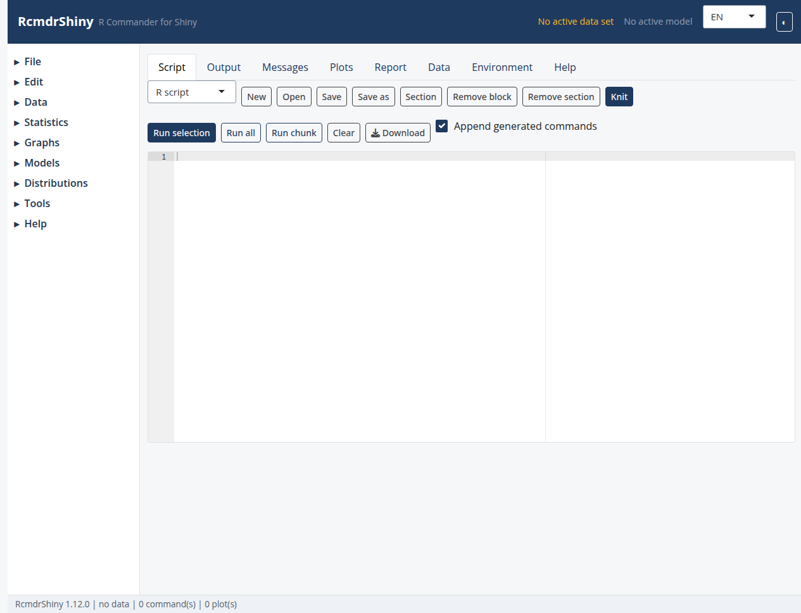

```{r, include=FALSE}
knitr::opts_chunk$set(collapse = TRUE, comment = "#>", eval = FALSE)
```

The application with the core menus; plugins add their own.

```{r screenshot, echo = FALSE, eval = TRUE, out.width = "100%"}

```

An RcmdrShiny plugin adds menus, direct commands and Shiny dialogs.  Plugins can
be delivered as a single R script or, preferably, as an R package named
`RcmdrShinyPlugin.<Name>`.

Starting with Wave 6.5, the 15 bundled plugins are **first-party modules**:
they are maintained and versioned with the application and target the internal
module contract. There is no external compatibility promise. New menus use the
stable `menu_id` / `item_id` registry described in
`vignette("menu-platform")`; the legacy `menus.txt` reader remains for the
migration and for script-only plugins.

# Package layout

```text
RcmdrShinyPlugin.Export/
├─ DESCRIPTION
├─ NAMESPACE
├─ R/plugin.R
├─ R/dialogs.R
├─ inst/etc/rcmdrshiny-menus.txt   # legacy migration source
├─ inst/menus/module.yml            # stable registry fragment
├─ man/
└─ tests/testthat/
```

`tools/new_plugin.R` creates the skeleton:

```bash
Rscript tools/new_plugin.R Export --title "Export R output" \
  --upstream RcmdrPlugin.Export
```

The package must depend on `RcmdrShiny (>= 1.1.0)`, export
`rcmdrshiny_plugin()`, and must not import `tcltk` or `tcltk2`.

The 15 plugins shipped under `plugins/` are **first-party modules**: they are
maintained and versioned with the application and target the internal SDK v2
contract. There is no external compatibility promise for third-party Tk
plugins.

# Menu file

First-party modules use the stable registry fragment at
`inst/menus/module.yml`:

```yaml
version: 1
module: demo
groups:
  - id: menu.demo
    parent: ""
    label: Demo plugin
    order: 5000
items:
  - id: item.demo.hello
    parent: menu.demo
    label: "Demo: Hello"
    command: demoHello
    order: 10
  - id: item.demo.dialog
    parent: menu.demo
    label: "Demo: Shiny dialog"
    command: demoDialog
    order: 20
```

The fragment declares `groups`, `items` and optional `removes`. A module may
remove an individual core command it replaces:

```yaml
removes:
  - target: numericalSummaries
    kind: command
    source_module: core
```

A first-party module does not delete a whole core menu: the curated shell and
its help entries remain available.

Legacy script plugins may still use the tabular `Rcmdr-menus.txt` format:

```text
    menu    demoMenu        topMenu         ""                          ""          ""  ""
    item    demoMenu        command         "Demo: Hello"               demoHello   ""  ""
    item    demoMenu        command         "Demo: Shiny dialog"        demoDialog  ""  ""
    item    topMenu         cascade         "Demo plugin"               demoMenu    ""  ""
```

The first column is `menu`, `item` or `remove`; the remaining columns follow
Rcmdr's conventions for parent, label, command, activation and installation
expressions.

# Registering the plugin

```r
#' @export
rcmdrshiny_plugin <- function() {
  RcmdrShiny::RcmdrShiny.plugin(
    name = "RcmdrShinyPlugin.Demo",
    menus = system.file("etc", "rcmdrshiny-menus.txt",
                        package = "RcmdrShinyPlugin.Demo"),
    commands = list(
      demoHello = function(state) {
        RcmdrShiny::run_command(state, 'cat("Hello from the plugin\\n")')
      }
    ),
    dialogs = list(
      demoDialog = RcmdrShiny::plugin_dialog(
        id = "demoDialog",
        title = "Demo dialog",
        ui = function(state, memory) {
          htmltools::tagList(
            RcmdrShiny::var_input(
              "demoDialog_var", "Variable",
              RcmdrShiny::numeric_variables(state)
            )
          )
        },
        on_ok = function(input, state) {
          list(commands = "1 + 1")
        }
      )
    ),
    predicates = list(
      hasDemoData = function() requireNamespace("datasets", quietly = TRUE)
    )
  )
}
```

`on_ok()` can return `commands`, `error`, `memory`, `activate_dataset`,
`activate_model`, `script`, `tab` or `message`, exactly like the built-in
dialog runtime.  `plugin_dialog()` forwards `help` and `help_package` to the
dialog's Help button.

# SDK v2

`plugin_api_version()` returns the current contract version (2).
`RcmdrShiny.plugin()` accepts `api_version` and rejects a version newer than
the running package. Each plugin records an `api_version` and a `module_id`
derived from its package name. `plugin_contract()` documents the stable fields:

| Area | Stable fields |
|---|---|
| Menu | `module_id`, `menu_id`, `item_id`, `command_id` |
| Dialog | `id`, `title`, `ui`, `on_ok`, `observers`, `help`, `help_topic`, `size`, `preview` |
| Extensions | component, preset, workflow, chart type, report template, help examples |

The extension hooks are additive:

```r
RcmdrShiny::plugin_ui_component("badge", render = function(text) {
  htmltools::tags$span(class = "badge", text)
})
RcmdrShiny::plugin_register_preset(
  "numericalSummaries", "Teaching", list(mean = TRUE, sd = TRUE)
)
RcmdrShiny::plugin_register_workflow(RcmdrShiny:::workflow_spec(
  id = "demo-flow", title = "Demo flow", description = "Two steps",
  steps = list(RcmdrShiny:::workflow_step("one", "One", command = "countMissing"))
))
RcmdrShiny::plugin_register_chart_type(list(
  id = "demo-chart", label = "Demo chart", group = "custom", mapping = list()
))
RcmdrShiny::plugin_register_report_template(list(
  id = "demo-report", title = "Demo report",
  description = "A short report", build = function(...) "# Demo"
))
RcmdrShiny::plugin_help_try_it("projects", list(
  list(code = "RcmdrShiny:::project_summary(AppState())",
       title = "Project summary", runnable = TRUE)
))
```

`plugin_dialog_preview(spec)` renders a dialog body without a session, which is
useful in package tests and documentation. `plugin_ui_component()` has two
forms: with `render` it registers a factory; without it, it renders the
registered component.

A plugin cannot replace a built-in workflow, chart type or report template by
id; it can only add a new one. Presets merge with the session presets, and a
session preset with the same name wins.

# Activation predicates

The `predicates` argument binds plugin functions in the menu activation
environment, so they can be used in the `activation` column.  A predicate can
take no arguments, or the application state, and must return a logical value.

```text
item    demoMenu    command    "Demo"    demoCommand    "hasDemoData()"    ""
```

Commands, dialogs and predicates cannot silently shadow core or earlier plugin
names.  Pass `replace = TRUE` only when a deliberate override is intended.

# Plugin helpers

Plugin packages can use the exported state accessors and widgets:

- `variables()`, `numeric_variables()`, `factor_variables()`, `dataset()`;
- `active_dataset()`, `active_model()`, `AppState()`, `run_command()`;
- `plugin_formula()` to build formula strings;
- `var_input()`, `checkbox_input()`, `checkboxes_input()`, `radio_input()`,
  `entry_input()`, `spin_input()`, `slider_input()`, `combo_input()`,
  `subset_input()`, `file_input()` and `dir_input()`;
- `tr()` and `available_languages()` for translation.

# Loading plugins

Package plugins are loaded by name. The loader can queue them with
`load_plugins(..., lazy = TRUE)` or
`options(RcmdrShiny.lazy_plugins = TRUE)`; the catalogue is materialised on the
first menu or command lookup.

```r
RcmdrShiny::run(plugins = "RcmdrShinyPlugin.Export")
```

Script plugins remain supported:

```r
RcmdrShiny::run(plugins = "path/to/plugin.R")
```

Several plugins can be combined:

```r
RcmdrShiny::run(plugins = c(
  "RcmdrShinyPlugin.Export",
  "RcmdrShinyPlugin.sos"
))
```

Or use *Utilities > Manage Rcmdr plug-ins...*, which lists the installed
`RcmdrShinyPlugin.*` packages and remembers the selection in the preferences
file.  Plugins named in the preferences are loaded by the next `run()`;
passing `plugins = character()` starts without them.  Menus are read at
startup, so a plugin loaded in a running session appears after reloading the
page (F5), not after restarting R: the command palette sees the new commands
immediately.

# Legacy Tk plugins

`load_plugin_package()` also detects legacy `RcmdrPlugin.*` packages that
provide `etc/menus.txt`.  They are registered with a warning, but Tk dialog
functions are not executed and their entries remain disabled.

# Inventory and tests

`tools/inventory_plugin.R` lists every menu entry in an upstream plugin, the R
function behind it, whether it uses Tk and whether it generates commands:

```bash
Rscript tools/inventory_plugin.R /path/to/RcmdrPlugin.Export
```

A plugin package should include golden tests for the generated commands and a
test that `rcmdrshiny_plugin()` registers with `RcmdrShiny`. The application
itself runs `tests/testthat/test-plugins-compat.R` against all 15 first-party
modules: it checks the package metadata, the registry fragment, the command
coverage and the absence of duplicate DOM keys when the packages are installed.

# Example

`system.file("examples", "demo-plugin.R", package = "RcmdrShiny")` contains a
small script plugin together with `demo-menus.txt`.
